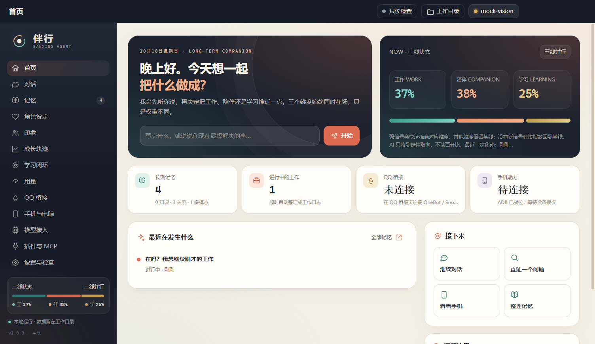

# 伴行 · 陪伴工作型 Agent

> 一个把「工作推进」「情感陪伴」与「学习探索」放在同一组连续状态向量上的本地智能体。  
> 内置 Hermes 长期记忆插件、通用 OneBot v11 / SnowLuma QQ 接入、QQ 主对话、可自改的知识线/情感线角色、mcp-phone.js 手机控制、可插拔 MCP / 插件口，以及只读环境检查脚本。

> **第一次使用：先看 [快速开始](快速开始.md)，然后双击 `启动伴行.bat`。**  
> 只想运行：下载/保留 `伴行Agent.exe`；只想开发：继续看下面的源码说明。



## 现在就能用

1. 双击工作目录下的 **`伴行Agent.exe`**；如果从开发终端启动，建议用 **`启动伴行.bat`**（会清掉 `ELECTRON_RUN_AS_NODE` 等干扰变量）。
2. 打开左侧 **模型接入**，填写 API URL 与 Key；应用会请求接口的 `/models`，自动探测可用模型并在下拉框中选择，不再手输模型名。然后点 **保存并测试**。
   - DeepSeek：`https://api.deepseek.com/v1`
   - OpenAI 兼容中转 / 本地 Ollama：填对应地址；Ollama 通常是 `http://127.0.0.1:11434/v1`
3. 回到 **对话** 开始。先说一句“我累了”试试三线状态变化，再让它查一个事实看看学习闭环。
4. QQ：如果已有任意 OneBot v11 网关（NapCat / Lagrange / LLOneBot / SnowLuma 等），在 **QQ 桥接** 选「手动 OneBot v11」，填 WS/HTTP 地址与 Token、主人 QQ，保存并启动。若用 SnowLuma，先手动启动 `integrations/SnowLuma/launcher.bat`，登录后在 WebUI 开启 OneBot HTTP/WS，再回来填；也可用自动发现模式。
5. 手机：在 **手机与电脑** 选择真机或模拟器，开启 USB 调试并授权后点刷新。独立 MCP 可用 `node mcp/phone/mcp-phone.js`（源码）或 `node mcp/phone/mcp-phone.bundle.mjs`（单文件构建）。

> 所有运行数据都在本文件夹内：`data/`（记忆/配置/日志/媒体）、`plugins/`、`vendor/`、`tools/`、`integrations/`。
> API Key 保存在 `data/config.json`，不会回显到界面；不要分享整个工作目录。

## 重要边界

- **SnowLuma 负责 QQ 客户端侧的 Hook/注入**。伴行不修改 QQ 进程，也不包含自动扫码或绕过平台限制的能力。SnowLuma 是第三方项目，使用可能违反平台条款并带来账号风险；它按其自身 EULA 运行，**没有被打进 exe**，只在工作目录中部署。
- **qq-bridge 上游**的主桥接进程面向 DeepSeek Harness Web API。本应用保留了 `vendor/qq-bridge` 的完整上游源码，并直接复用其 SnowLuma 端点自发现（`snowluma-conn.js`）与白名单安全语义，把后端 replacement 为本地 Agent Core。QQ 侧仍然是标准 OneBot v11 WS/HTTP，与 qq-bridge 文档中的架构一致。
- **Hermes 插件**是内置长期记忆插件的名称，提供跨层召回、受控写入与权重反思。插件协议很小，也可以按同一接口接入 Hermes 风格的本地插件。
- 手机/电脑控制默认最小权限：电脑默认关闭，手机 Shell 默认关闭，QQ 空白名单不放行。请只操作自己的设备与账号。

## 已实现的功能

### 1. 分层记忆（Hermes）
- **知识库**：事实条目保留 `verifiedAt`、来源 URL/信源分、置信度、有效期与 revisions；过时只标记，不静默改写。命中过时条目时会先自动复核；也可在记忆页批量复核过时知识。
- **关系记忆**：偏好、情感事件、人格画像、边界；独立存储、优先注入上下文。
- **工作日志**：工作轨迹自动跟踪，超过 5 小时（可配置）无继续则用模型整理为工作日志；也可手动归档。
- **状态轨迹**：每条用户发言、时间衰减、话题锚点恢复和 AI 微调都写入三线状态历史，可回看、反思。
- **多模态记忆**：用户图片、音频、QQ 图片/语音、手机截图、MCP 生成媒体统一落到 `data/memory/media/`，元数据入 `multimodal.jsonl`。**桌面截图是例外**：只在“手机与电脑”页面临时查看，不写入多模态记忆。

### 2. 三线连续状态向量
- 状态是 `[work, companion, learning]` 三个连续维度，归一化为 1；不是三个互斥开关。
- **快变量**：每个维度有自己的强信号检测器。“我累了”会让陪伴立刻越过工作；目标维度至少到高阈值，其他维度保留 baseline，再归一化。工作上下文只被压低，不会被覆盖。
- **慢变量**：没有新信号时，每个维度按自己的半衰期指数回到 baseline（工作约 20 分钟、陪伴约 90 分钟、学习约 45 分钟）；baseline 非零，代表“仍然能工作/陪伴/学习”的身份。
- **冷却与迟滞**：强事件有冷却；反向触发需要更高置信度，避免来回震荡。
- **话题锚点**：工作/学习信号会留下话题锚点；再次说“继续刚才那个”且话题相似时，恢复当时的权重配置，而不只是加载摘要。
- **5 小时转存**：超过约 5 小时没有工作信号，当前工作压缩为工作日志，并写入锚点供后续恢复；工作维度回到 baseline，不是归零。
- **学习维度**：学习信号升高会触发知识空白检查/联网采集，归档后学习维度回落。
- **检索优先级**：陪伴高时关系记忆优先；工作/学习高时知识库优先。
- **AI 微调**：AI 不读百分比，但可 `weight_read` 看定性状态，并用 `weight_tune` 做有冷却、有限力度的修正。
- UI 提供三线占比、历史曲线与轨迹；AI 提示词中不会出现百分比或原始向量。

### 3. 自学习闭环
1. 空白识别：知识召回置信不足，或用户质疑旧知识。
2. 联网搜集：Bing 搜索（可切 SearXNG），多组关键词并行。
3. 读取正文：安全抓取（拒绝内网/本机地址、限制大小与类型）。
4. 信源鉴定：域名层级、相关性、正文质量、时效、交叉印证共同打分。
5. 交叉验证：有模型时让主模型输出结构化判断；无模型时使用保守启发式。
6. 筛选归档：不足阈值、或没有主模型参与综合时只入候选（candidate），不写成确定事实。
7. 质疑重验与比对：重新采集后按 replace / merge / keep / conflict 处理；冲突双方都保留。

所有闭环都写入 `data/learning/cycles.jsonl`，UI 可查看 7 步轨迹、来源分和结论。

### 4. 模型接入与辅助问答
- OpenAI 兼容与 Anthropic Messages 协议。
- **模型名自动探测**：填写 URL 与 Key 后请求 `/v1/models`（失败自动回退 `/models`；Anthropic 为 `/v1/models`），从返回列表选择；不提供手输模型名。官方 DeepSeek V4.1 Flash 的模型 ID 是 `deepseek-flash`，列表里的 `input_modalities` 会标记「支持图片」。可在模型页点「自动探测模型」刷新，URL/Key 变化时也会自动重探。
- 接入时自动验证：文字连通、测试图编号（验证视觉）、工具调用能力。测试图是应用自带的 42 数字图片。
- 辅助多模态模型只通过 `ask_helper` 接受主模型限定任务，不能自行控制 QQ/设备；主模型必须审核其结果。
- 支持本机 Ollama 发现、任意 OpenAI 兼容本地端点、MCP 服务（stdio/HTTP）扩展。

### 5. QQ / OneBot 桥接
- **自动发现 SnowLuma**：OneBot HTTP + WebSocket，自动读取 per-account token 与端口。
- **手动 OneBot v11**：不依赖 SnowLuma 配置文件，直接填 WS/HTTP 地址；NapCat、Lagrange、LLOneBot、go-cqhttp、SnowLuma 等均可。WS Token 与 HTTP Token 可不同。
- **QQ 主对话**：主人私聊进入桌面“对话”；在 QQ 里直接聊，回答自动发回 QQ；在应用里发的消息，其回答也会回写主人 QQ（不会伪装发送你的原话）。
- **拟人化发送**：按文本长度等待、尝试 `set_input_status` 正在输入、分条发送、随机条间停顿、深夜变慢；QQ 文本会清理 Markdown、标题和分点。
- **角色稳定性护栏**：知识线需要多条稳定证据；情感线不直接由 AI 改写，而是先写第一人称情感记忆，再按重复主题筛选分层。主要跨天/冷却时间门槛已移除；仍保留证据量、7 天上限、锁定与回滚。主人以外的人的印象不会进入人设校准。
- **群聊 / 私聊活跃度**：独立成两张卡片，各有“手动 / AI 动态”模式，用滑杆调节，不再填数字。群聊控制非 @ 消息的接话概率与冷却；私聊控制安静后自主查资料、按开关看手机、再开新话题的频率。AI 动态模式下，后台按群热度和当前权重自动调，拖动滑杆会切回手动。
- **记忆可手动修正**：关系记忆、进行中/已归档工作日志、多模态说明与标签都能直接编辑；桌面截图只在设备页临时查看，不写入多模态。
- **搜索/爬虫**：Bing RSS/HTML → DuckDuckGo → Wikipedia 多引擎回退；正文抓取去除导航/脚本等样板；用户直接粘贴 URL 时会先抓取正文再回答，不反问“HTTP 是什么”。
- **表情包**：内置 8 张本地表情包；用户发过的 QQ 表情包/图片会带 `表情包` 标签进入多模态记忆。AI 先用 `sticker_search` 找到 `mediaId`，再用 `send_sticker` 发送；内置和已保存表情都能发。
- **Hermes 长期记忆**：更正原 Harmes 命名；提供分层召回、稳定/情感记忆区分、反思与三线成长摘要，配置会自动迁移，不重置 API/记忆/角色。
- **Prompt 缓存友好**：稳定 system 前缀与动态记忆分离，动态内容只放在本轮 user 尾部，减少整段前缀失效。
- **角色自迭代**：`persona_self_update` 只校准知识线；情感线由 `emotional_note` → 情感记忆 → 主题分层 → 稳定情感线。保留证据量、锁定与回滚。
- **戳一戳 / 并发消息**：识别 OneBot poke notice；同一会话 900ms 窗口内的多条消息先缓存打分，只选与当前对话最相关的一条处理，其他作为上下文。
- **引用与长短回复**：QQ 在回复消息/被 @ 时自动带 reply 引用；普通闲聊短回复，明确复杂任务才允许长回复。
- **多模态插件插槽**：识图、OCR、语音转写、文档解析、图像生成 5 个插槽，可分配给主/辅助模型；子模型只返回观察/处理结果，最终回答仍由主模型完成。
- **日记**：`data/diary/diary.jsonl`，AI 可 `diary_write`，用户可查看/手写/删除，或让 AI 回看对话后写今天。
- **音乐 / 清唱**：侧边栏「音乐」可一键探测/接入网易云 CDP、读取当前播放、搜索/歌词、播放控制；客户端点歌失败时回退公开直链并真的在本机播放。本地 Windows SAPI 生成清唱语音；可选外部 RVC（`infer_cli.py` + `.pth` + index）自动变声，失败回退 SAPI。AI 通过 `music_now` / `music_lyrics` / `music_play` / `music_sing` 使用，当前 QQ 会话可直接发语音。
- **多模态自定义端点**：5 个插槽除 primary/helper 外，可为每个插槽单独填写 API URL、协议、模型名和 Key（也可填本地 Ollama/LM Studio）。主模型统一编排，子端点只返回观察结果。
- **闲时自学习与自主活动**：白名单会话安静 1 小时后，后台可自行搜索/学习，也可自己拿起手机/电脑玩 B 站、视频、游戏或探索应用；不向用户发消息。活动有步数、间隔、设备开关和 APK 下载开关，记录写入 `data/autonomy/sessions.jsonl`。空闲门槛、检查间隔、两次学习间隔、每日次数、静默起止时间都可在页面/配置中修改。
- **搜索与爬虫**：支持 Bing / DuckDuckGo / Wikipedia / 百度 / 搜狗 / SearXNG 多选；可用本机 Edge/Chrome 无头浏览器渲染动态页面，提取正文、链接和视频标签；视频页面可归档元数据并下载到多模态记忆（流媒体只存元数据）。
- **情感素材证据**：自学习内容涉及人类关系/陪伴/信任/孤独等主题时，先写第一人称情感记忆（`data/persona/emotional-memory.jsonl`）；系统按标签/情绪/强度筛选分层后才形成情感线。
- **自由发散 + 四审 + 回退**：闲时自学习不限定固定选题，可以自由发散；但每个选题先审四项：安全范围、隐私信息、政治/色情/暴力/高风险、是否空泛古怪。任一项不通过就回退到预设安全方向，不硬发。搜索结果、正文、知识写入还有内容过滤。知识用于变聪明，人类情感/关系内容只写关系记忆用于变有人情味；同一条内容不会双写。
- **人物印象**：群聊与私聊共用一本人物账本，以 QQ 号为稳定主键、昵称双显示；亲近度随对话动态变化，印象由模型/规则动态刷新，可删除、可手动修改并用开关锁定。昵称变化会自动刷新该 QQ 在关系记忆中的昵称，并按人隔离关系记忆。
- **用量侧边栏**：按今天/最近 7 天统计输入、输出、总 token，上下文缓存命中率、记忆召回命中率、当前上下文窗口占比，并按桌面/QQ 对话和模型拆分。数据写入 `data/usage/events.jsonl`。
- 主人私聊 / 白名单私聊 / 白名单群；群聊默认必须 @ 机器人。
- 图片与语音进入多模态记忆；文字消息进入同一个记忆/权重上下文。
- 所有发送都经过白名单与敏感信息脱敏；不能主动联系白名单外的人。
- qq-bridge 上游源码与 MIT 许可保留在 `vendor/qq-bridge`。

### 5.1 知识线 / 情感线角色设定
- 基础身份（名字、角色、关系）与安全边界固定，不可被 AI 修改。
- **知识线**：怎么求真、怎么标注不确定、怎么处理来源与时效。
- **情感线**：怎么接住情绪、怎么陪伴、怎么保持边界。
- 用户可直接编辑；知识线可由 AI 在稳定证据出现时小步修订。情感线不直接改写，先写第一人称情感记忆，再分层形成；完整框架见 [docs/人格演化框架.md](docs/人格演化框架.md)。
- 每次修改写入 `data/persona/revisions.jsonl`，保留 before/after、理由与证据；UI「角色设定」页可查看。
- 也可在角色页点“让 AI 根据记忆校准”做一次显式校准。

### 6. 手机与电脑
- `mcp/phone/mcp-phone.js`（可独立运行源码）+ `mcp-phone.bundle.mjs`（便携单文件）。
- ADB 真机 / Android Studio AVD 模拟器两种模式；支持设备列表、截图、UI dump、点击、滑动、输入、系统键、启动应用、无线连接、启动 AVD。
- 截图自动写入多模态记忆；主模型无法直接看图时，可通过辅助视觉模型观察。
- 电脑端：截图、窗口列表、点击、Unicode 输入、按键、启动应用；Shell 双重开关，默认关闭。

### 7. 插件口与 MCP
- `plugins/<id>/plugin.json` + `index.js`，导出 `activate(api)`。
- API：`registerTool()`、`on(hook, fn)`、`memory`、`weights`、`logger`。
- 内置 `plugins/hermes` 与示例 `plugins/example-tool`。
- MCP 服务可在 UI 添加/启动/停止/重启；`mcp/phone`、`mcp/computer` 有示例；支持 HTTP MCP 以接虚拟机/本地模型服务。

### 8. 只读检查
- 独立文件：**`检查环境-只读.bat`**（工作目录根）+ `check-readonly.ps1`（同一目录）。
- 内置副本：`scripts/check-readonly.bat` / `scripts/check-readonly.ps1`，并以资源形式打入 exe；首次运行会复制到 exe 同目录。
- BAT 只做纯 ASCII 启动，检查逻辑在 PowerShell 助手里，避免 cmd 解析 UTF-8 中文时产生伪错误。
- UI「设置与检查 → 运行只读检查」执行同一份脚本，展示结果。
- 脚本只使用 `if exist`、`where`、读取 JSON、读取文件哈希和本机 TCP 连接，不创建/修改/删除文件。

## 文件结构

```
陪伴工作型agent/
├─ 伴行Agent.exe                 最终便携应用（构建产物）
├─ 启动伴行.bat                  清除环境变量干扰后启动 exe
├─ 检查环境-只读.bat             独立只读检查入口（纯 ASCII 启动器）
├─ check-readonly.ps1            只读检查逻辑助手（与 BAT 放在一起）
├─ data/                         全部运行数据（配置、记忆、日志、媒体）
├─ plugins/                      插件（Hermes + 示例）
├─ mcp/
│  ├─ phone/mcp-phone.js         独立手机 MCP（源码）
│  ├─ phone/mcp-phone.bundle.mjs 手机 MCP 单文件（便携 exe 使用）
│  └─ computer/                  电脑 MCP 与 desktop.ps1
├─ vendor/qq-bridge/             qq-bridge 上游源码（MIT）
├─ tools/platform-tools/         ADB 37.0.1
├─ integrations/SnowLuma/        SnowLuma 官方 Windows 发行包（未打入 exe）
├─ vendor/ai-companion-kit/      两篇文章对应的 MIT 仓库（OneBot transport / 角色 / phone-mcp 参考）
├─ src/main/                     Electron 主进程、Agent、记忆、学习、QQ、手机、角色线
├─ src/renderer/                 无框架 UI
├─ docs/                         用户手册、架构、第三方许可、手机说明、文章精读
└─ scripts/                      构建、自检、mock、文章抓取、只读检查源码
```

## 自检

```powershell
npm run check                       # 权重/记忆/模型 mock/MCP/脚本（不写正式记忆）
node scripts/stale-selftest.mjs     # 过时知识自动复核顺序
node scripts/persona-selftest.mjs   # 知识线/情感线、证据与 AI 校准
node scripts/qq-selftest.mjs        # 手动 OneBot + QQ 主对话 + 群/私聊活跃度
node scripts/behavior-selftest.mjs  # 权重不可读 + 自主查资料开话题
node scripts/weight-decay-selftest.mjs # 三线归一化、指数衰减、5h 转存、锚点、AI 微调
node scripts/people-selftest.mjs    # QQ/昵称、亲近度、印象、手动锁定、按人隔离
node scripts/usage-selftest.mjs     # token 输入/输出、缓存/记忆命中率与对话拆分
node scripts/qq-humanize-selftest.mjs # QQ Markdown 清理与拟人化延迟边界
node scripts/model-discovery-selftest.mjs # URL+Key 探测模型与 input_modalities
node scripts/model-vision-selftest.mjs # 视觉探测、reasoning_content 与 max_tokens
node scripts/hermes-selftest.mjs     # Hermes 插件、分层记忆与成长
node scripts/improvements-selftest.mjs # 泄漏/长度/缓存前缀/工具权限/记忆分层/表情包
node scripts/qq-selftest.mjs        # 含戳一戳、批量消息与主动话题
node scripts/memory-edit-selftest.mjs # 关系/工作/多模态手动修正
node scripts/research-selftest.mjs  # 真实 Bing 搜索的学习闭环
node scripts/e2e-features.mjs 9223 13000  # 端到端：角色/记忆编辑/图片/OneBot/主动话题/截图（需 mock 服务）
node scripts/ui-smoke-cdp.mjs 9223 18080  # UI 冒烟（需先启动 mock 模型与 DevTools）
```

## 开发与重新打包

```powershell
npm install
npm run build:mcp
npm start
npm run build          # 产出 dist/伴行Agent-1.0.0-portable.exe
```

构建环境需要 Node.js 22.13+ 与联网下载 Electron（本机已安装）。  
便携 exe 不包含 SnowLuma 二进制，避免违反其 EULA；请保留 `integrations/SnowLuma` 或自行从官方 Release 安装。

## 参考

- qq-bridge：<https://github.com/Derpyu520/qq-bridge>
- SnowLuma：<https://github.com/SnowLuma/SnowLuma> · <https://snowluma.github.io/zh/>
- 两篇小黑盒文章已用 **Microsoft Edge Headless** 渲染抓取，原文与精读见 [docs/articles/README.md](docs/articles/README.md)；其对应的 MIT 仓库在 `vendor/ai-companion-kit`。
- 工程实现以实际 OneBot v11 协议、SnowLuma / qq-bridge 文档和本机实测为准。

## 许可

本应用源码采用 MIT。第三方组件与 SnowLuma 的许可边界见 [docs/第三方与许可.md](docs/第三方与许可.md)。SnowLuma 官方发行包不在本应用 exe 中；请遵守其 EULA，仅限个人/非商业使用。

